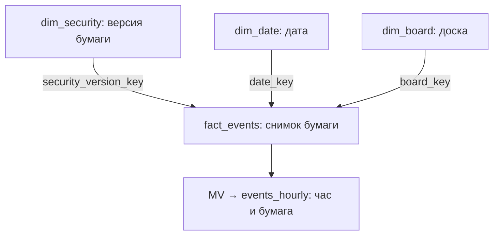

# ЛР5. Показ на сдаче — два пункта с доски

Показываем: **1) витрину и графики; 2) все слои ClickHouse и DDL**. Ниже — порядок действий на уже работающем стенде. Повторная загрузка данных для показа не нужна.

На фото указан Apache Superset. В твоём варианте и выполненном проекте используется **DataLens**. Здесь дан показ реально работающего дашборда; если преподаватель требует именно Superset, это отдельная смена BI, которая ещё не выполнена.

## 1. Показать витрину и объяснить графики

**Открой в браузере:**

<http://localhost:8088/dashboards/n0sxb2bwyk7g6>

Если видишь `Unauthorized access`, сначала войди на <http://localhost:8088>: логин `admin`, пароль `student`, если не менял. Потом открой дашборд. В обоих адресах используй `localhost`.

**Сначала скажи, что за данные:**

> Это данные MOEX по акциям доски TQBR. Сборщик периодически получает состояние бумаг. Одно событие — один полученный снимок бумаги. Поэтому на графиках количество снимков, а не число биржевых сделок и не денежный оборот. Время — UTC.

Дальше покажи графики сверху вниз:

| Что видно | Что сделать на экране | Что объяснить |
|---|---|---|
| **События по часам суток** | Наведи курсор на высокий столбец и прочитай час и число событий. Затем наведи на низкий. | По X — час UTC, по Y — число снимков за этот час, суммарно по всем датам. Столбцы позволяют сравнить часы суток. Это не хронологический ряд отдельных календарных часов. |
| **Топ-10 бумаг по событиям** | Наведи на первый столбец, назови `SECID` и число событий. Сравни со следующей бумагой. | По X — бумаги, по Y — число полученных снимков. Порядок от большего к меньшему показывает лидеров по частоте наблюдений. Большое число снимков само по себе не означает большой оборот. |
| **Бумаг с событиями за сутки** | Наведи на две даты и сравни количество бумаг. | По X — дата UTC, по Y — число различных бумаг, по которым есть события за сутки. Это покрытие сбора, не число всех событий. Distinct считается за сутки, его нельзя получать суммой почасовых distinct. |

**Что сказать об источнике витрины:**

> DataLens подключён к ClickHouse. Графики читают представления `mart.dashboard_hourly`, `mart.dashboard_top`, `mart.dashboard_daily`. Они построены над почасовым агрегатом `mart.events_hourly`. Агрегат считает материализованное представление при загрузке фактов.

Если спросят, почему нет некоторых дат или часов: «На графике показаны имеющиеся наблюдения. Пропуск в сборе не доказывает, что на бирже не было торгов».

**Результат пункта:** преподаватель видит все три графика без ошибок, ты можешь назвать смысл осей, единицу наблюдения и источник данных каждого графика.

## 2. Показать все слои данных ClickHouse и объяснить DDL

### Открыть SQL-консоль

В **обычном терминале WSL**:

```bash
cd ~/stand
docker compose ps warehouse
```

В колонке `STATUS` должно быть `Up`. Подключись к ClickHouse с учётными данными, уже заданными контейнеру:

```bash
docker compose exec warehouse sh -c 'exec clickhouse-client --user "$CLICKHOUSE_USER" --password "$CLICKHOUSE_PASSWORD"'
```

Появится приглашение вида `… :)`. **Следующие SQL вставляй сюда, а не в Bash.** Выход обратно в WSL — команда `exit`.

Все запросы для этого пункта собраны в [jobs/lr5_acceptance.sql](jobs/lr5_acceptance.sql). Можно открыть файл в редакторе и брать из него блоки по одному. Это только чтение.

### Показать, какие слои и объекты есть

```sql
SELECT name AS database
FROM system.databases
WHERE name IN ('stg', 'core', 'mart')
ORDER BY name;
```

**Ожидаешь три строки:** `core`, `mart`, `stg`.

```sql
SELECT database, name AS object, engine, total_rows
FROM system.tables
WHERE database IN ('stg', 'core', 'mart')
ORDER BY database, name;
```

**Теперь объясни строки этого списка:**

| Слой | Объекты | Назначение |
|---|---|---|
| `stg` — приём | `events`, `events_load` | Принимает очищенный Parquet из S3. Суточная загрузка сначала готовится в `events_load`, потом публикуется. |
| `core` — ядро | `events`, `security_changes` | Хранит события и изменения статуса бумаги по времени события. |
| `mart` — витрина | `fact_events`, `dim_security`, `dim_date`, `dim_board` | Факт и три измерения — модель «звезда». |
| `mart` — агрегат | `events_hourly`, `mv_events_hourly` | Число снимков по часу и бумаге; MV считает его при вставке фактов. |
| `mart` — загрузка | `fact_events_load`, `events_hourly_load`, `mv_events_hourly_load` | Готовят новую порцию фактов и её агрегат перед заменой партиций. |
| `mart` — графики | `dashboard_hourly`, `dashboard_top`, `dashboard_daily` | Три SQL View, которые читает DataLens. |

`total_rows` — число собственных строк хранения объекта. У обычного View и MV оно может быть пустым: это не означает отсутствие данных в результате запроса. MV здесь пишет строки в целевую таблицу `events_hourly`.

### Показать, что основные слои заполнены

```sql
SELECT 'stg.events' AS table, count() AS events FROM stg.events
UNION ALL
SELECT 'core.events', count() FROM core.events
UNION ALL
SELECT 'mart.fact_events', count() FROM mart.fact_events;
```

Контрольные результаты твоего запуска:

| table | events |
|---|---:|
| stg.events | 8 164 287 |
| core.events | 8 164 287 |
| mart.fact_events | 8 164 287 |

Если данные обновлялись, числа могут отличаться. В подготовленном состоянии три количества совпадают.

Покажи несколько строк, чтобы было понятно, что хранит факт:

```sql
SELECT SECID, event_time, date_key, board_key, last_price, bid, offer
FROM mart.fact_events
LIMIT 5;
```

**Куда смотреть:** `SECID` — бумага, `event_time` — время снимка, `board_key` — TQBR, `last_price/bid/offer` — значения из снимка. Это пример строк, а не выборка «пяти самых новых»: без `ORDER BY` такой порядок не обещается.

### Объяснить DDL по настоящему файлу проекта

**Открой `jobs/warehouse_create.sql` в редакторе. Не запускай его заново.** Иди по следующим блокам:

| Найди в файле | Что показать и сказать |
|---|---|
| `CREATE DATABASE ... stg/core/mart` | «Созданы три базы для трёх слоёв». |
| `CREATE TABLE ... stg.events` | «`String` хранит ключи и коды, `DateTime64(3, 'UTC')` — время с миллисекундами, `Nullable(Float64)` допускает отсутствие цены. `event_date` вычисляется из времени снимка». |
| `ENGINE = MergeTree` | «Основные данные хранятся в физических таблицах ClickHouse». |
| `PARTITION BY event_date` / `date_key` | «Отдельная партиция на UTC-сутки. Повторную загрузку дня можно опубликовать заменой одной партиции». |
| `ORDER BY (SECID, event_time, event_key)` | «Так физически сортируются данные. Это не ограничение уникальности и не автоматическое удаление дублей». |
| `CREATE TABLE ... core.security_changes` | «Хранит моменты изменения атрибута бумаги». |
| `CREATE TABLE ... mart.dim_security` | «У версии бумаги есть `valid_from`, `valid_to`, `is_current`; старые статусы сохраняются». |
| `CREATE TABLE ... mart.fact_events` | «Одна строка — один снимок. `security_version_key`, `date_key`, `board_key` связывают его с измерениями». |
| `CREATE TABLE ... mart.dim_date` и `dim_board` | «Справочники дат и торговых досок». |
| `CREATE TABLE ... mart.events_hourly` | «`SummingMergeTree` хранит количества событий по часу и бумаге. При чтении используется `sum(events)`, потому что части могут ещё не слиться». |
| `CREATE MATERIALIZED VIEW ... TO mart.events_hourly` | «На входе вставленные факты. `toStartOfHour` округляет время до часа, `count()` считает снимки, результат записывается в целевой агрегат». |
| `CREATE TABLE ... AS ...` для `_load` | «Создаёт загрузочную таблицу с той же структурой. Это не команда копирования строк». |
| `CREATE OR REPLACE VIEW ... dashboard_*` | «Это сохранённые SELECT для трёх графиков. Собственных данных у обычного View нет». |

**Зачем звезда:** одна бумага встречается во многих снимках и может менять статус. Факт хранит событие и ссылку на нужную версию бумаги; измерения хранят её атрибуты, дату и доску.



Если попросят показать фактический DDL из работающего ClickHouse, в SQL-консоли выполни **по одной**:

```sql
SHOW CREATE TABLE stg.events FORMAT TSVRaw;
```

```sql
SHOW CREATE TABLE mart.dim_security FORMAT TSVRaw;
```

```sql
SHOW CREATE TABLE mart.fact_events FORMAT TSVRaw;
```

```sql
SHOW CREATE TABLE mart.mv_events_hourly_load FORMAT TSVRaw;
```

Это читает определения уже существующих объектов. Ключевые места в выводе те же: колонки и типы, движок, партиция, сортировка, SELECT материализованного представления.

### Показать путь загрузки между слоями

**Открой `jobs/stg_load.sql`:** найди `FROM s3(`, затем `REPLACE PARTITION`.

> Сутки Parquet читаются из объектного хранилища в `stg.events_load`. Затем их партиция публикуется в `stg.events` и `core.events`. Повтор того же дня заменяет данные, а не добавляет их второй раз.

**Открой `jobs/security_history.sql`:** покажи заполнение `core.security_changes` и `mart.dim_security`.

> Из событий ядра выделяются изменения статуса. Для них строятся версии с интервалами действия.

**Открой `jobs/mart_load.sql`:** покажи `ASOF INNER JOIN` и две последние команды.

> Событие соединяется с версией бумаги, действовавшей в его время. Затем заменяются партиции фактов и агрегата. `REPLACE PARTITION` само не запускает MV, поэтому агрегат заранее считается MV над загрузочной таблицей.

Если нужно наглядно показать историю одной бумаги, выполни:

```sql
SELECT SECID, attribute AS status, valid_from, valid_to, is_current
FROM mart.dim_security
WHERE SECID = 'SMCF'
ORDER BY valid_from
LIMIT 8;
```

У `SMCF` в сохранённом наборе есть реальные изменения статуса. Несколько строк одной бумаги — версии, а не случайные дубли. Интервал действия — `[valid_from, valid_to)`.

**Результат пункта:** ты показал все три базы, все объекты в них, заполненность основных таблиц и строки факта; объяснил типы, движки, партиции, сортировку, измерения, обычные View и MV на DDL своего проекта.
